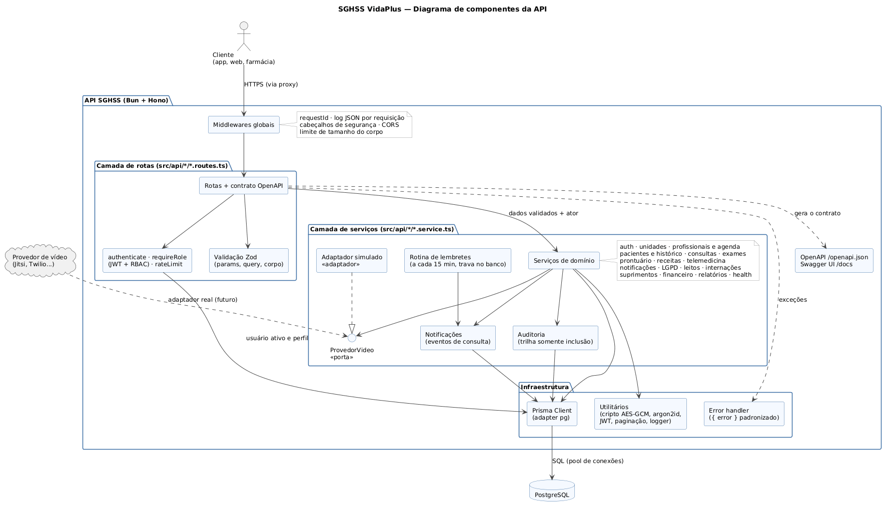

# SGHSS API — VidaPlus

[](https://github.com/JlucasFaria/sghss-api/actions/workflows/ci.yaml)

API REST do **Sistema de Gestão Hospitalar e de Serviços de Saúde (SGHSS)** da instituição VidaPlus, que administra hospitais, clínicas de bairro, laboratórios e equipes de home care.

Projeto desenvolvido para a disciplina de Projeto Multidisciplinar (UNINTER), com ênfase em **Back-end**.

## Objetivo

Centralizar em uma única API segura:

- cadastro e atendimento de pacientes (consultas, exames, prontuários);
- gestão de profissionais de saúde (agendas e prescrições);
- administração hospitalar (leitos, internações, estoque, financeiro e relatórios);
- telemedicina (teleconsultas e receitas digitais);
- segurança e compliance (controle de acesso por perfil, auditoria e LGPD).

## Funcionalidades

| Módulo                   | O que a API oferece                                                                                                       |
| ------------------------ | ------------------------------------------------------------------------------------------------------------------------- |
| Acesso                   | Autocadastro do paciente com aceite do termo, login com JWT e cinco perfis (ADMIN, MEDICO, ENFERMEIRO, TECNICO, PACIENTE) |
| Cadastros                | Unidades, profissionais (CRM/COREN) e pacientes, com inativação lógica                                                    |
| Agenda e consultas       | Horários por profissional, agendamento sem conflito, cancelamento e reagendamento com prazo, exames com resultado         |
| Prontuário e receitas    | Evoluções somente de inclusão, conclusão do atendimento, receita digital com código verificável pela farmácia             |
| Telemedicina             | Sala de vídeo por provedor externo (porta e adaptador), janela de entrada e token temporário                              |
| Notificações             | Avisos de agendamento, cancelamento, reagendamento e lembretes das próximas 24 horas                                      |
| Administração hospitalar | Leitos, internações (internar, transferir, dar alta), estoque com alerta de mínimo, lançamentos financeiros e relatórios  |
| Compliance e LGPD        | Trilha de auditoria, consentimento versionado, exportação dos dados do titular e anonimização                             |

A lista completa das 70 rotas, com perfis e exemplos de requisição e resposta, está em [`docs/endpoints.md`](docs/endpoints.md).

## Arquitetura



A API é organizada em camadas, com uma pasta por domínio em `src/api/`: as **rotas** definem o contrato OpenAPI e aplicam autenticação, perfil e limites de requisição; os **schemas Zod** validam toda entrada na borda; os **serviços** concentram as regras de negócio, as transações, a auditoria e as notificações; o **Prisma** acessa o PostgreSQL. A API é stateless (JWT), o que permite escalar horizontalmente com réplicas atrás de um proxy, e cada registro operacional aponta para a sua unidade, atendendo às várias unidades da VidaPlus com um único banco.

| Documento                                  | Conteúdo                                                                               |
| ------------------------------------------ | -------------------------------------------------------------------------------------- |
| [Requisitos](docs/requisitos.md)           | Requisitos funcionais e não funcionais, e as decisões tomadas no projeto               |
| [Casos de uso](docs/casos-de-uso.md)       | Atores e casos de uso, com diagramas por ator                                          |
| [Modelagem](docs/modelagem.md)             | DER, diagrama de classes e decisões de modelagem                                       |
| [Arquitetura](docs/arquitetura.md)         | Sequência (agendamento e teleconsulta), estados da consulta, componentes e implantação |
| [Endpoints](docs/endpoints.md)             | Todas as rotas, perfis e exemplos JSON                                                 |
| [Rastreabilidade](docs/rastreabilidade.md) | Requisito → caso de uso → endpoint → teste                                             |
| [Plano de testes](docs/plano-de-testes.md) | Estratégia, casos de teste, critérios de aceitação, resultados e riscos                |

## Decisões técnicas

- **Concorrência tratada no banco.** Agendamento, internação, estoque e transições da consulta usam atualizações condicionais e travas de linha dentro de transações: com requisições simultâneas, só uma vence e as demais recebem 409. Há testes de concorrência para esses casos.
- **Registros clínicos e auditoria somente de inclusão.** Prontuário, auditoria e lançamentos financeiros não têm rota de edição ou exclusão; correções geram um novo registro. `DELETE` de cadastros com histórico clínico faz inativação lógica.
- **Ação e efeitos na mesma transação.** A auditoria e a notificação de uma operação são gravadas junto com ela: se algo falha, nada fica pela metade.
- **Integração por porta e adaptador.** O provedor de vídeo é uma interface; o adaptador simulado pode ser trocado por um real sem mexer nas regras, e a falha do provedor vira 502 sem gravar estado parcial.
- **Contrato gerado do código.** O OpenAPI e o Swagger (`/docs`) saem das próprias rotas e schemas, então a documentação não se desatualiza.

As justificativas de cada regra de negócio estão na seção de decisões de [`docs/requisitos.md`](docs/requisitos.md).

## Segurança e LGPD

- **Autenticação e autorização:** JWT com expiração de 1 hora; a conta é verificada a cada requisição (inativação vale na hora); RBAC por rota; recurso de outro usuário responde 404, sem revelar que existe.
- **Senhas e dados sensíveis:** senhas com argon2id; CPF, telefone, prontuário e resultados de exames cifrados com AES-256-GCM; busca por CPF por HMAC, sem decifrar a tabela; CPF mascarado nas listagens.
- **Entradas:** validação Zod em todas as rotas, rejeição de HTML e script em textos, limite de tamanho do corpo, cabeçalhos de segurança e CORS configurável.
- **Abuso:** limites de tentativas no login, no cadastro, na validação de receita e na anonimização; IP real atrás de proxy confiável (`TRUST_PROXY`).
- **Minimização:** o ADMIN gerencia cadastros e leitos, mas não lê dados clínicos (motivo da consulta, prontuário, motivo da internação).
- **Direitos do titular:** consentimento versionado com revogação, exportação dos próprios dados em JSON e anonimização que preserva os registros clínicos de guarda obrigatória.
- **Rastreabilidade:** trilha de auditoria de leituras e alterações sensíveis, consultável só pelo ADMIN; erros internos respondem 500 genérico, sem detalhes.
- **Verificação:** varredura OWASP ZAP sem alertas pendentes (veja [`tests/README.md`](tests/README.md)).

## Stack

| Camada         | Tecnologia                                       |
| -------------- | ------------------------------------------------ |
| Runtime        | [Bun](https://bun.sh)                            |
| Framework HTTP | [Hono](https://hono.dev) com `@hono/zod-openapi` |
| Validação      | Zod                                              |
| Banco de dados | PostgreSQL 16                                    |
| ORM            | Prisma 7 com adapter `pg`                        |
| Testes         | `bun:test`, k6 (carga), OWASP ZAP (segurança)    |
| Qualidade      | TypeScript estrito, ESLint, Prettier             |
| Infraestrutura | Docker (imagem multi-stage) e Docker Compose     |
| CI             | GitHub Actions                                   |

## Como rodar

### Com Docker (API e banco)

Pré-requisito: [Docker](https://www.docker.com). O Docker Compose sobe o PostgreSQL, aplica as migrations e inicia a API (imagem multi-stage, usuário não-root).

```bash
cp .env.example .env
docker compose up -d --build

# Popular o banco com dados fictícios (opcional, recomendado para avaliar)
docker compose run --rm migrate bun run db:seed
```

A API fica em `http://localhost:3000`, com o Swagger em `http://localhost:3000/docs`. Ela só inicia depois que o banco está saudável e as migrations foram aplicadas; se o processo cair, o Docker a reinicia (`restart: unless-stopped`).

### Para desenvolver (Bun local)

Pré-requisitos: [Bun](https://bun.sh) 1.3+ e Docker (para o banco).

```bash
bun install                # instala as dependências e gera o Prisma Client
cp .env.example .env
bun run db:up              # sobe só o PostgreSQL
bun run db:deploy          # aplica as migrations
bun run db:seed            # dados fictícios
bun run dev                # API com recarga automática
```

Para verificar: `GET /health` (processo no ar) e `GET /health/ready` (inclui o banco).

### Produção

Com o `.env` copiado do exemplo, a API roda em modo **desenvolvimento**: aceita os segredos de exemplo e o CORS aberto, o que serve para avaliar localmente. Para produção, ajuste o `.env`:

- `NODE_ENV="production"`: com ele, a API se recusa a iniciar com os segredos do exemplo ou com `CORS_ORIGIN="*"`;
- `JWT_SECRET`, `ENCRYPTION_KEY` e `CPF_HASH_KEY` novos (o comando para gerar está no `.env.example`) e guardados em local seguro;
- `CORS_ORIGIN` com as origens do front-end e `POSTGRES_PASSWORD` forte;
- proxy reverso com HTTPS na frente da API, com o IP dele em `TRUST_PROXY`;
- monitor externo chamando `/health/ready` e backup diário (veja abaixo).

## Como testar

### Swagger

Com a API rodando e o seed aplicado, abra `http://localhost:3000/docs`, faça login em `POST /auth/login` e use o token no botão **Authorize**. Usuários fictícios do seed (somente desenvolvimento), todos com a senha `Vidaplus@2026`:

| Perfil     | E-mail                           |
| ---------- | -------------------------------- |
| ADMIN      | `admin@vidaplus.example`         |
| MEDICO     | `ana.souza@vidaplus.example`     |
| MEDICO     | `carlos.lima@vidaplus.example`   |
| ENFERMEIRO | `beatriz.rocha@vidaplus.example` |
| PACIENTE   | `joao.pereira@vidaplus.example`  |
| PACIENTE   | `maria.santos@vidaplus.example`  |

### Postman

A pasta [`docs/postman`](docs/postman/README.md) tem a coleção com o fluxo autenticado completo (do login à validação da receita) e casos negativos, com asserções em cada requisição, e o environment para rodar localmente.

### Testes automatizados

Os testes usam um banco separado (`sghss_test`), esvaziado a cada teste.

```bash
cp .env.test.example .env.test   # ajuste a senha conforme o .env
bun run db:test:prepare          # cria o banco de testes e aplica as migrations
bun test                         # executa os testes
bun run test:coverage            # com cobertura (falha se algum arquivo ficar abaixo de 80%)
```

O relatório em formato LCOV fica em `coverage/lcov.info`; no CI, ele é publicado como artefato de cada execução.

### Carga e segurança

Carga com k6 e varredura de segurança com OWASP ZAP rodam via Docker contra a API local (`bun run test:carga` e `bun run test:seguranca`); veja [`tests/README.md`](tests/README.md). O [plano de testes](docs/plano-de-testes.md) reúne a estratégia, os casos de teste e os resultados obtidos.

## Backup e restauração

```bash
bun run db:backup
```

Gera `backups/<banco>-<data>.dump` com `pg_dump` (formato custom, compactado) dentro do container do PostgreSQL e apaga os backups com mais de `BACKUP_RETENCAO_DIAS` dias (padrão: 7). A pasta `backups/` fica fora do controle de versão; em produção, copie os arquivos para outro local (outro disco ou armazenamento externo). Para backups diários, agende o comando no cron (Linux) ou no Agendador de Tarefas (Windows), por exemplo `0 2 * * * cd /caminho/sghss-api && bun run db:backup`.

O dump contém dados pessoais (nome, e-mail, consultas e trilha de auditoria) e é gravado com permissão de leitura só para o dono do arquivo. Os campos sensíveis (CPF, telefone, prontuário e resultados de exames) já estão cifrados no banco: guarde as cópias fora do servidor e **nunca no mesmo lugar que a `ENCRYPTION_KEY`**: sem ela, esses campos não podem ser lidos.

Para restaurar (substitui os dados atuais do banco):

```bash
docker compose exec -T postgres pg_restore --clean --if-exists --no-owner -U sghss -d sghss < backups/sghss-AAAA-MM-DDTHH-MM-SS.dump
```

## Scripts

| Script                    | Descrição                                     |
| ------------------------- | --------------------------------------------- |
| `bun run dev`             | Inicia a API com recarga automática           |
| `bun run start`           | Inicia a API                                  |
| `bun test`                | Executa os testes                             |
| `bun run test:coverage`   | Executa os testes com relatório de cobertura  |
| `bun run test:carga`      | Teste de carga com k6 (Docker; API rodando)   |
| `bun run test:seguranca`  | Varredura OWASP ZAP (Docker; API rodando)     |
| `bun run lint`            | Verifica o código com ESLint                  |
| `bun run lint:fix`        | Corrige automaticamente problemas do ESLint   |
| `bun run format`          | Formata o código com Prettier                 |
| `bun run format:check`    | Verifica a formatação                         |
| `bun run typecheck`       | Verifica os tipos com TypeScript              |
| `bun run db:up`           | Sobe só o PostgreSQL e aguarda ficar saudável |
| `bun run db:stop`         | Para os containers (mantém os dados)          |
| `bun run db:down`         | Remove os containers (mantém o volume)        |
| `bun run db:logs`         | Acompanha os logs do PostgreSQL               |
| `bun run db:generate`     | Gera o Prisma Client                          |
| `bun run db:migrate`      | Cria e aplica migrations em desenvolvimento   |
| `bun run db:deploy`       | Aplica migrations pendentes (CI/produção)     |
| `bun run db:seed`         | Popula o banco com dados fictícios (dev)      |
| `bun run db:studio`       | Abre o Prisma Studio                          |
| `bun run db:backup`       | Backup do banco com retenção (pg_dump)        |
| `bun run db:test:prepare` | Cria o banco de testes e aplica as migrations |
| `bun run docs:diagramas`  | Gera os PNGs dos diagramas PlantUML (Docker)  |

## Estrutura

```
src/
├── api/<dominio>/   # rotas (*.routes.ts), regras (*.service.ts), schemas (*.schema.ts) e testes
├── config/          # variáveis de ambiente validadas e termo de uso
├── db/              # cliente Prisma
├── middlewares/     # autenticação e perfis, rate limit, log e tratamento de erros
├── utils/           # criptografia, token, validadores, paginação, logger
├── test/            # helpers de teste (reset do banco e factories)
├── app.ts           # composição da aplicação (usada nos testes)
└── index.ts         # ponto de entrada do servidor
prisma/              # schema, migrations e seed
docs/                # requisitos, modelagem, arquitetura, endpoints, testes e Postman
tests/               # testes não funcionais: carga (k6) e segurança (OWASP ZAP)
scripts/             # backup do banco
```
