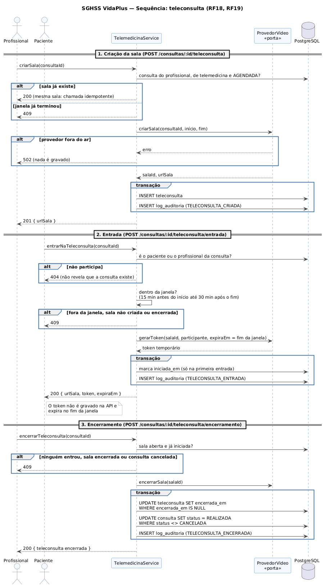

# Arquitetura do SGHSS — VidaPlus

Este documento descreve como a API se comporta nos fluxos principais e como ela é organizada e implantada. A estrutura dos dados está em [modelagem](modelagem.md); os requisitos atendidos, em [requisitos](requisitos.md).

Fontes PlantUML em [`diagramas/`](diagramas/); para regerar os PNGs, rode `bun run docs:diagramas`.

## Diagramas de sequência

### Agendamento de consulta

O agendamento é o fluxo mais disputado do sistema: vários pacientes podem tentar o mesmo horário ao mesmo tempo. A autenticação consulta o banco a cada requisição, para que uma conta inativada perca o acesso na hora. Dentro de uma única transação, o serviço trava o registro do paciente (evitando que dois agendamentos dele driblem a checagem de conflito) e reserva o horário com uma atualização condicional (`status = DISPONIVEL`): só uma requisição consegue a reserva, e a outra recebe 409. A consulta, o registro de auditoria e a notificação são gravados na mesma transação; qualquer falha desfaz tudo.

### Teleconsulta

O provedor de vídeo é acessado por uma porta (`ProvedorVideo`) com um adaptador simulado, que pode ser trocado por um provedor real sem alterar as regras. O profissional cria a sala; paciente e profissional entram dentro da janela de horário (15 minutos antes do início até 30 minutos após o fim) e recebem um token temporário, que não é gravado na API. Se o provedor estiver fora do ar, a API responde 502 sem gravar nada. O encerramento fecha a sala e conclui a consulta, com atualizações condicionais que impedem dois encerramentos e não sobrescrevem um cancelamento simultâneo.
