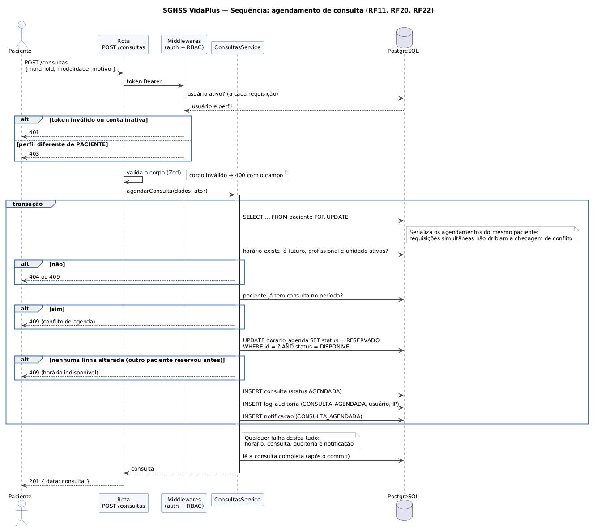
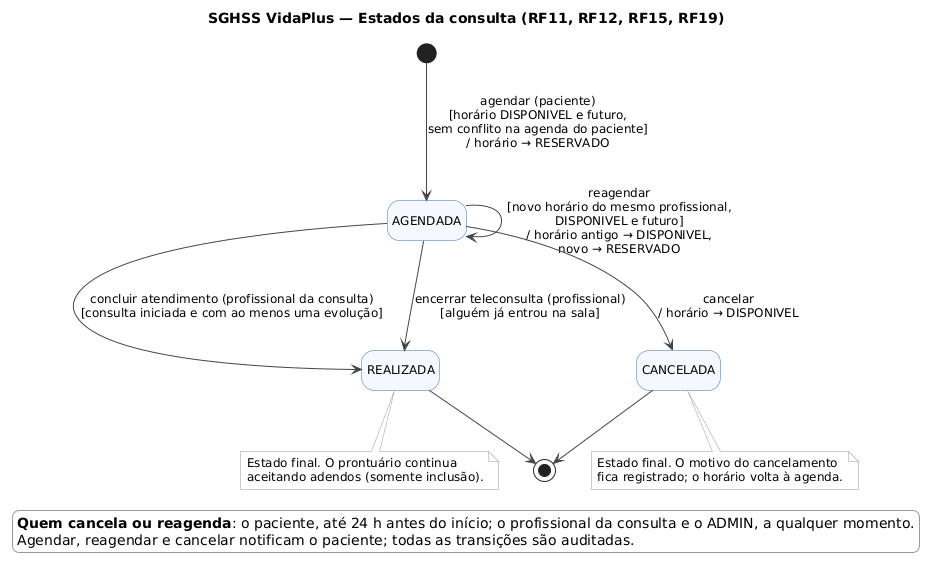
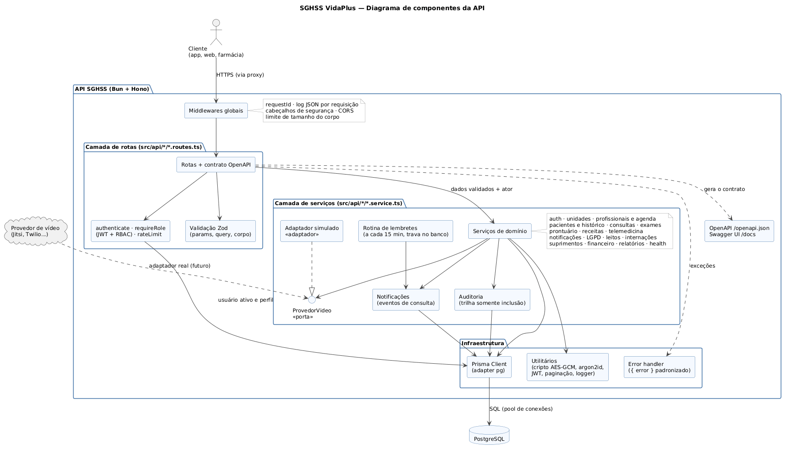
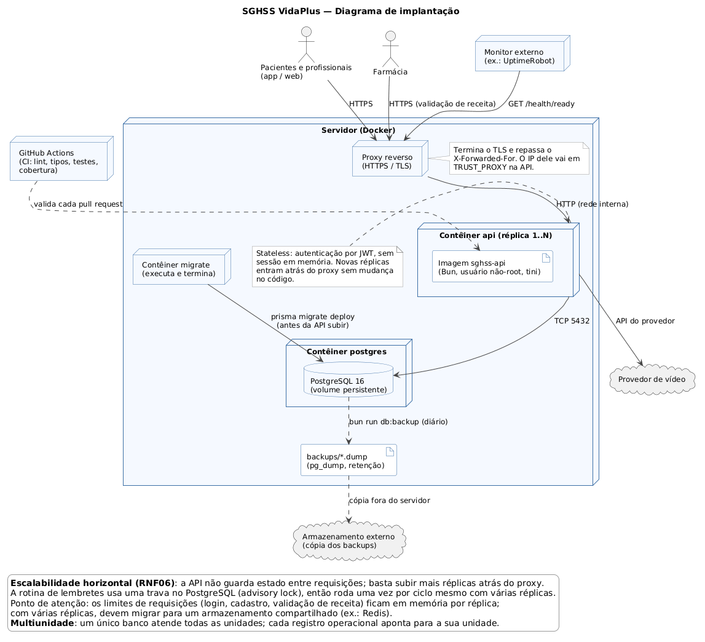

# Arquitetura do SGHSS — VidaPlus

Este documento descreve como a API se comporta nos fluxos principais e como ela é organizada e implantada. A estrutura dos dados está em [modelagem](modelagem.md); os requisitos atendidos, em [requisitos](requisitos.md).

Fontes PlantUML em [`diagramas/`](diagramas/); para regerar os PNGs, rode `bun run docs:diagramas`.

## Diagramas de sequência

### Agendamento de consulta

O agendamento é o fluxo mais disputado do sistema: vários pacientes podem tentar o mesmo horário ao mesmo tempo. A autenticação consulta o banco a cada requisição, para que uma conta inativada perca o acesso na hora. Dentro de uma única transação, o serviço trava o registro do paciente (evitando que dois agendamentos dele driblem a checagem de conflito) e reserva o horário com uma atualização condicional (`status = DISPONIVEL`): só uma requisição consegue a reserva, e a outra recebe 409. A consulta, o registro de auditoria e a notificação são gravados na mesma transação; qualquer falha desfaz tudo.

### Teleconsulta

O provedor de vídeo é acessado por uma porta (`ProvedorVideo`) com um adaptador simulado, que pode ser trocado por um provedor real sem alterar as regras. O profissional cria a sala; paciente e profissional entram dentro da janela de horário (15 minutos antes do início até 30 minutos após o fim) e recebem um token temporário, que não é gravado na API. Se o provedor estiver fora do ar, a API responde 502 sem gravar nada. O encerramento fecha a sala e conclui a consulta, com atualizações condicionais que impedem dois encerramentos e não sobrescrevem um cancelamento simultâneo.

## Diagrama de estados da consulta

A consulta tem apenas três estados. Ela nasce `AGENDADA` e termina em `REALIZADA` (quando o profissional conclui o atendimento ou encerra a teleconsulta) ou `CANCELADA`. O reagendamento não cria um estado próprio: a consulta continua `AGENDADA`, em outro horário do mesmo profissional, e o horário antigo volta à agenda. As transições são atualizações condicionais no banco: cancelar, reagendar e concluir só valem com `status = AGENDADA`, e o encerramento da teleconsulta não sobrescreve um cancelamento (`status <> CANCELADA`). Assim, operações simultâneas sobre a mesma consulta não produzem estados inconsistentes.

## Diagrama de componentes

A API é organizada em camadas, uma pasta por domínio em `src/api/` (ex.: `consultas/`), com três arquivos por módulo:

| Camada       | Arquivo        | Responsabilidade                                                                                        |
| ------------ | -------------- | ------------------------------------------------------------------------------------------------------- |
| Rotas        | `*.routes.ts`  | Define o contrato OpenAPI, aplica autenticação, perfil (RBAC) e rate limit, e repassa ao serviço        |
| Validação    | `*.schema.ts`  | Schemas Zod de entrada e saída: a requisição só chega ao serviço com dados válidos (400 caso contrário) |
| Serviços     | `*.service.ts` | Regras de negócio, transações, auditoria e notificações                                                 |
| Persistência | Prisma Client  | Acesso tipado ao PostgreSQL, com o driver `pg`                                                          |

As rotas são finas: não contêm regra de negócio. Isso mantém as regras testáveis e permite trocar a interface (por exemplo, uma fila de mensagens) sem reescrevê-las. Auditoria e notificações são serviços compartilhados: nas operações de escrita, são gravados na mesma transação da ação; leituras de dados sensíveis também são auditadas. O provedor de vídeo é acessado pela porta `ProvedorVideo` (padrão porta e adaptador), o ponto de integração com serviços externos. O contrato OpenAPI é gerado a partir das próprias rotas, então a documentação em `/docs` não se desatualiza em relação ao código.

## Diagrama de implantação

O repositório já entrega a parte interna do servidor: o `docker-compose.yaml` sobe o PostgreSQL com volume persistente, aplica as migrations num contêiner que executa e termina, e só então inicia a API (imagem multi-stage, usuário não-root). O proxy reverso com HTTPS, o monitor externo da rota `/health/ready` e a cópia dos backups para fora do servidor compõem a arquitetura-alvo de produção, descrita no [README](../README.md).

**Escalabilidade horizontal (RNF06).** A API é stateless: a autenticação usa JWT e nenhuma sessão fica em memória, então novas réplicas podem entrar atrás do proxy sem mudança de código. A rotina de lembretes usa uma trava do PostgreSQL (advisory lock) e roda uma única vez por ciclo, mesmo com várias réplicas. O ponto de atenção são os limites de requisições (login, cadastro e validação de receita), hoje em memória de cada réplica: com mais de uma réplica, eles devem migrar para um armazenamento compartilhado, como o Redis.

**Multiunidade.** Um único banco atende hospitais, clínicas, laboratórios e home care. Cada registro operacional (profissional, consulta, exame, leito, suprimento, lançamento) aponta para a sua unidade, o que permite filtrar operações e relatórios por unidade sem bancos separados.
