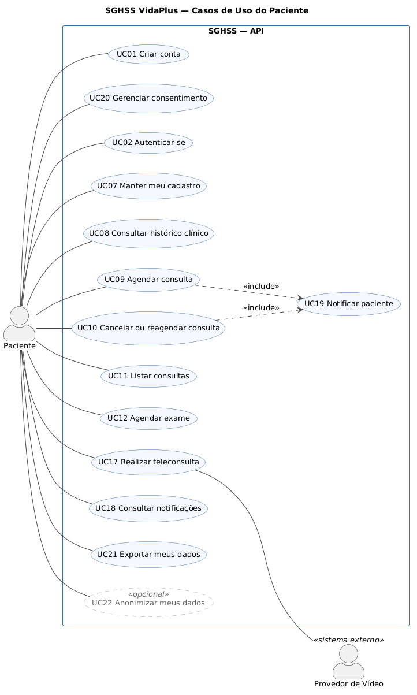
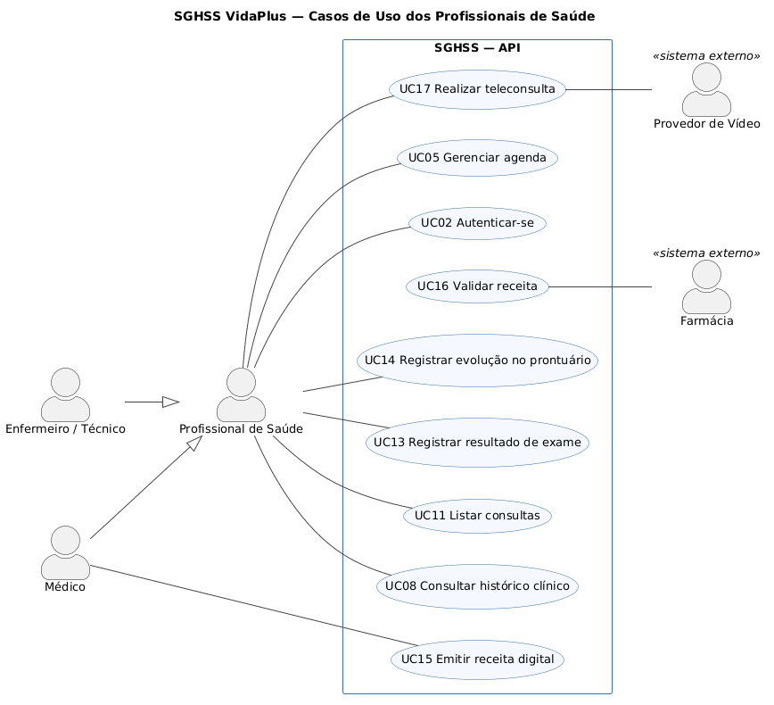
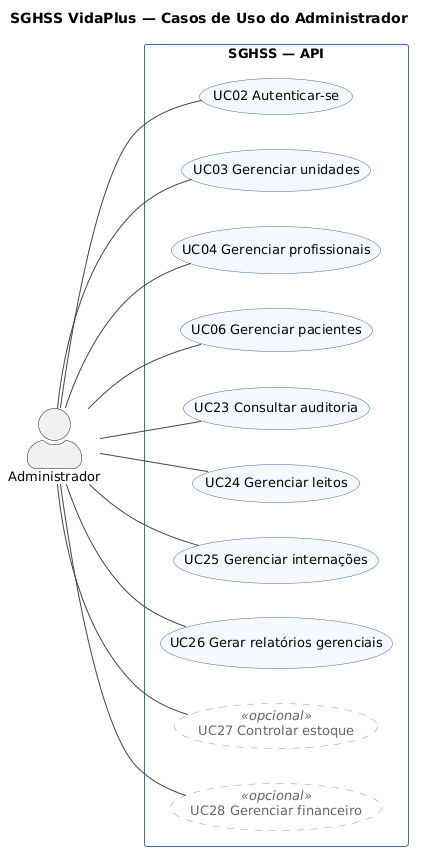

# Casos de uso do SGHSS — VidaPlus

Os casos de uso derivam dos [requisitos](requisitos.md) e são a origem dos endpoints da API: cada caso de uso vira uma ou mais operações REST (por exemplo, "UC06 Gerenciar pacientes" → `GET/PUT/DELETE /pacientes/:id`).

Para manter os diagramas legíveis, eles foram separados por grupo de atores. A numeração dos casos de uso é única entre os três diagramas. Fontes PlantUML em [`diagramas/`](diagramas/); para regerar os PNGs, rode `bun run docs:diagramas`.

## Atores

| Ator                  | Tipo            | Papel                                                                      |
| --------------------- | --------------- | -------------------------------------------------------------------------- |
| Paciente              | Usuário         | Titular dos dados; agenda, acompanha e participa dos atendimentos.         |
| Profissional de Saúde | Usuário         | Generalização de Médico e Enfermeiro/Técnico: agenda, prontuário e exames. |
| Médico                | Usuário         | Herda do Profissional de Saúde e, além disso, emite receitas digitais.     |
| Enfermeiro / Técnico  | Usuário         | Herda do Profissional de Saúde.                                            |
| Administrador         | Usuário         | Gerencia cadastros, unidades, leitos, internações, relatórios e auditoria. |
| Farmácia              | Sistema externo | Confere a autenticidade de receitas pelo código de verificação, sem login. |
| Provedor de Vídeo     | Sistema externo | Hospeda as salas de teleconsulta criadas pela API.                         |

## Diagramas

### Paciente

### Profissionais de saúde

### Administrador

## Descrição dos casos de uso

| ID   | Caso de uso                        | Atores                                    | Requisitos | Descrição                                                                                               |
| ---- | ---------------------------------- | ----------------------------------------- | ---------- | ------------------------------------------------------------------------------------------------------- |
| UC01 | Criar conta                        | Paciente                                  | RF01       | O paciente informa seus dados, aceita o termo de uso de dados (consentimento inicial) e recebe acesso.  |
| UC02 | Autenticar-se                      | Todos os usuários                         | RF02, RF03 | O usuário entra com e-mail e senha, recebe um token e pode consultar os próprios dados de acesso.       |
| UC03 | Gerenciar unidades                 | Administrador                             | RF05       | Cadastra, lista, consulta, atualiza e inativa hospitais, clínicas, laboratórios e equipes de home care. |
| UC04 | Gerenciar profissionais            | Administrador                             | RF06       | Cadastra o profissional (com usuário de acesso), mantém seus dados e o inativa.                         |
| UC05 | Gerenciar agenda                   | Profissional de Saúde                     | RF07       | Abre e bloqueia horários e consulta a agenda do dia.                                                    |
| UC06 | Gerenciar pacientes                | Administrador                             | RF08       | Lista pacientes com paginação, busca por CPF, atualiza e inativa cadastros.                             |
| UC07 | Manter meu cadastro                | Paciente                                  | RF09       | O paciente consulta e corrige os próprios dados cadastrais.                                             |
| UC08 | Consultar histórico clínico        | Paciente, Profissional de Saúde           | RF10       | Exibe consultas, exames, prescrições e internações; o profissional só vê pacientes que atende.          |
| UC09 | Agendar consulta                   | Paciente                                  | RF11       | Escolhe profissional, horário livre e modalidade (presencial ou teleconsulta). Inclui UC19.             |
| UC10 | Cancelar ou reagendar consulta     | Paciente                                  | RF12       | Cancela ou move a consulta com pelo menos 24 horas de antecedência. Inclui UC19.                        |
| UC11 | Listar consultas                   | Paciente, Profissional de Saúde           | RF13       | Lista as consultas do usuário, com filtros de data e status.                                            |
| UC12 | Agendar exame                      | Paciente                                  | RF14       | Solicita a marcação de um exame em uma unidade.                                                         |
| UC13 | Registrar resultado de exame       | Profissional de Saúde                     | RF14       | Registra o resultado e conclui o exame.                                                                 |
| UC14 | Registrar evolução no prontuário   | Profissional de Saúde                     | RF15       | Adiciona evoluções clínicas à consulta (conteúdo criptografado) e conclui o atendimento.                |
| UC15 | Emitir receita digital             | Médico                                    | RF16       | Emite a receita com itens e posologia; o sistema gera o código de verificação.                          |
| UC16 | Validar receita                    | Farmácia                                  | RF17       | Consulta o código e recebe se a receita é autêntica, com os dados mínimos para dispensação.             |
| UC17 | Realizar teleconsulta              | Paciente, Profissional, Provedor de Vídeo | RF18, RF19 | Cria a sala no provedor e libera a entrada só aos participantes da consulta, na janela de horário.      |
| UC18 | Consultar notificações             | Paciente                                  | RF21       | Lista as notificações e as marca como lidas.                                                            |
| UC19 | Notificar paciente                 | — (incluído por UC09 e UC10)              | RF20       | Gera a notificação de consulta agendada, cancelada ou próxima.                                          |
| UC20 | Gerenciar consentimento            | Paciente                                  | RF24       | Registra ou revoga consentimentos de tratamento de dados, com finalidade e versão do termo.             |
| UC21 | Exportar meus dados                | Paciente                                  | RF25       | Gera um arquivo JSON com todos os dados do titular (portabilidade).                                     |
| UC22 | Anonimizar meus dados _(opcional)_ | Paciente                                  | RF26       | Remove a identificação pessoal, preservando os registros clínicos de guarda obrigatória.                |
| UC23 | Consultar auditoria                | Administrador                             | RF23       | Pesquisa a trilha de auditoria por usuário, ação e período.                                             |
| UC24 | Gerenciar leitos                   | Administrador                             | RF27       | Cadastra leitos por unidade e ala e altera seu status.                                                  |
| UC25 | Gerenciar internações              | Administrador                             | RF28       | Interna, transfere e dá alta, ocupando e liberando leitos de forma consistente.                         |
| UC26 | Gerar relatórios gerenciais        | Administrador                             | RF29       | Emite relatórios de ocupação de leitos e de consultas por período e unidade.                            |
| UC27 | Controlar estoque _(opcional)_     | Administrador                             | RF30       | Registra entradas e saídas de suprimentos e alerta sobre estoque mínimo.                                |
| UC28 | Gerenciar financeiro _(opcional)_  | Administrador                             | RF31       | Registra lançamentos financeiros e apresenta o resumo por período e unidade.                            |

## Requisitos transversais

Dois requisitos funcionais não aparecem como casos de uso próprios porque se aplicam a todos eles:

- **RF04 — Controle de acesso por perfil:** cada caso de uso só pode ser executado pelos atores associados a ele no diagrama.
- **RF22 — Trilha de auditoria:** os casos de uso que leem ou alteram dados sensíveis (cadastros, prontuário, receitas, internações e dados do titular) geram registro de auditoria automaticamente.
