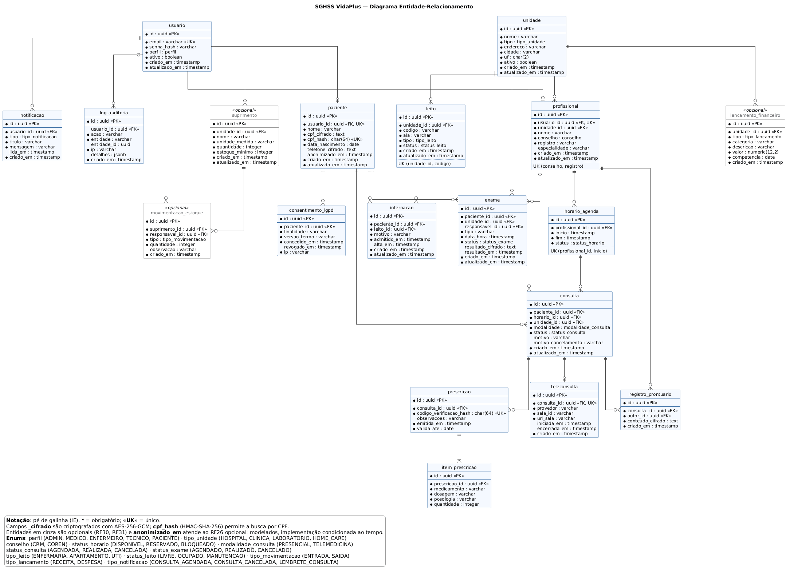
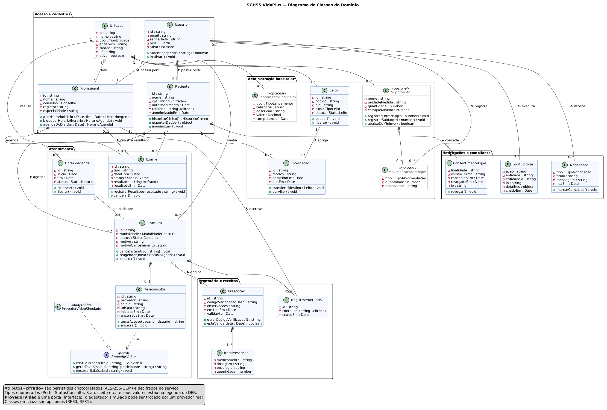

# Modelagem de dados do SGHSS — VidaPlus

O modelo parte dos [requisitos](requisitos.md) e dos [casos de uso](casos-de-uso.md): cada caso de uso indica quais dados precisam existir e como se relacionam. O DER descreve o banco relacional (PostgreSQL) implementado com Prisma; o diagrama de classes descreve as mesmas entidades sob a ótica orientada a objetos, com o comportamento (regras de negócio) que os serviços da API executam.

Fontes PlantUML em [`diagramas/`](diagramas/); para regerar os PNGs, rode `bun run docs:diagramas`.

## Diagrama Entidade-Relacionamento (DER)

## Diagrama de classes

## Entidades por módulo

| Módulo                    | Entidades                                                     | Requisitos                 |
| ------------------------- | ------------------------------------------------------------- | -------------------------- |
| Acesso e cadastros        | `usuario`, `unidade`, `paciente`, `profissional`              | RF01–RF09                  |
| Agenda, consultas, exames | `horario_agenda`, `consulta`, `teleconsulta`, `exame`         | RF07, RF10–RF14, RF18–RF19 |
| Prontuário e receitas     | `registro_prontuario`, `prescricao`, `item_prescricao`        | RF15–RF17                  |
| Administração hospitalar  | `leito`, `internacao`                                         | RF27–RF29                  |
| Opcionais                 | `suprimento`, `movimentacao_estoque`, `lancamento_financeiro` | RF30, RF31                 |
| Notificações e compliance | `notificacao`, `log_auditoria`, `consentimento_lgpd`          | RF20–RF26                  |

## Decisões de modelagem

- **Usuário separado do perfil clínico.** `usuario` guarda apenas credenciais e o perfil de acesso (RBAC); `paciente` e `profissional` guardam os dados de cada papel em relação 1:0..1. O administrador não precisa de entidade própria. Isso mantém a autenticação única para todos os perfis (RF02, RF04).
- **Chaves UUID.** Identificadores não sequenciais evitam que um ID revele volume de cadastros ou permita adivinhar registros de outros pacientes (enumeração), e facilitam a geração distribuída em múltiplas unidades (RNF06).
- **Dados sensíveis cifrados (RNF01).** CPF, telefone, resultado de exame e conteúdo do prontuário são gravados criptografados com AES-256-GCM (colunas `_cifrado`). Como o texto cifrado muda a cada gravação, a busca e a unicidade do CPF usam `cpf_hash`, um HMAC-SHA-256 com chave própria — não é possível recuperar o CPF a partir dele.
- **Multiunidade (RNF06).** Profissionais, leitos, consultas, exames e lançamentos referenciam a `unidade`, o que permite filtrar operações e relatórios por hospital, clínica, laboratório ou home care. A `consulta` grava a própria unidade para preservar o histórico mesmo que o profissional mude de lotação.
- **Agenda sem conflito (RF11).** Cada consulta ocupa um `horario_agenda`. Ao agendar, o serviço muda o status do horário de `DISPONIVEL` para `RESERVADO` com uma atualização condicional dentro de uma transação, de modo que duas requisições simultâneas não reservem o mesmo horário. O cancelamento devolve o horário para `DISPONIVEL`; por isso um horário pode ter várias consultas no histórico, mas só uma ativa. O profissional da consulta é obtido pelo horário, sem coluna repetida em `consulta` que pudesse divergir dele. A restrição única `(profissional_id, inicio)` impede horários duplicados.
- **Teleconsulta como entidade própria (RF18, RF19).** Os dados da sala (provedor, identificador e URL) ficam em `teleconsulta`, ligada 1:0..1 à consulta. O token de acesso é gerado na entrada e não é armazenado. O provedor de vídeo é acessado por uma interface (`ProvedorVideo`) com adaptador simulado.
- **Prontuário e auditoria somente para inclusão (RNF05).** `registro_prontuario` e `log_auditoria` não têm data de atualização: correções no prontuário geram um novo registro, preservando o histórico exigido para documentos clínicos. O autor do registro (`autor_id`) pode ser diferente do profissional da consulta (por exemplo, a enfermagem).
- **Receita verificável (RF16, RF17).** Na emissão, o serviço gera um código aleatório de 256 bits (gerador criptográfico), entregue uma única vez ao médico/paciente junto com a receita. O banco guarda apenas `codigo_verificacao_hash` (SHA-256 do código): como o código não deriva de dados da receita, não pode ser adivinhado, e um vazamento do banco não expõe códigos válidos. A farmácia informa o código, a API calcula o hash e localiza a receita; a rota pública tem limite de requisições para impedir tentativas em massa.
- **Inativação lógica.** Usuários e unidades têm `ativo` em vez de exclusão física, pois registros clínicos vinculados têm guarda obrigatória. A anonimização (RF26, opcional) é indicada por `anonimizado_em`.
- **Internação e ocupação de leito (RF28).** A internação aponta para o leito atual; internar, transferir e dar alta atualizam a internação e o `status` dos leitos na mesma transação. As transferências ficam registradas na trilha de auditoria.
- **Consentimento versionado (RF24).** Cada aceite registra finalidade, versão do termo, data e IP; a revogação preenche `revogado_em` sem apagar o aceite original, servindo como prova para a LGPD.
- **Convenção de nomes.** No banco, tabelas e colunas usam `snake_case`; no código (modelos Prisma e TypeScript), `camelCase`, mapeados com `@map`/`@@map`.
